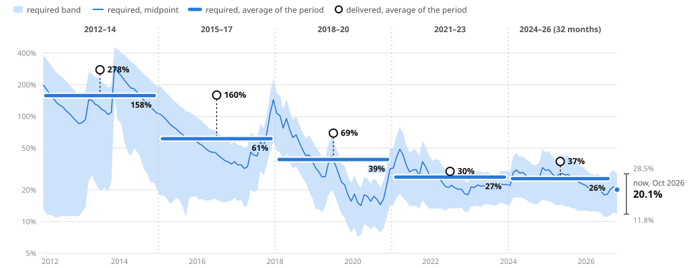
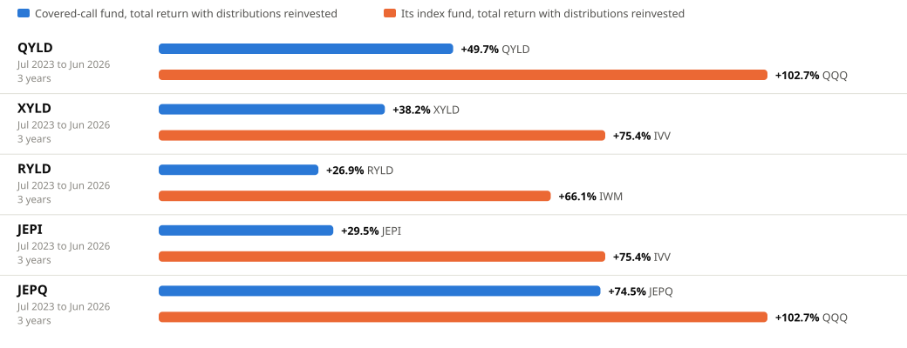

## Agisilaos Papadogiannis

**Independent finance research on what an asset is worth and what return it must earn. Two live tools recompute the answers from current public data, and nine of the 21 papers come with the data and code to check every number.**

<a href="https://papers.ssrn.com/sol3/cf_dev/AbsByAuth.cfm?per_id=7457522">SSRN</a> · <a href="https://scholar.google.com/citations?user=RihXr08AAAAJ">Google Scholar</a> · <a href="https://orcid.org/0009-0002-7753-7052">ORCID</a> · <a href="https://scarcitythinker.substack.com">Substack</a> · <a href="mailto:apapadogiannis@gmail.com">Email</a>

9 of the 21 are published or forthcoming in peer-reviewed journals: Financial Economics Letters, Frontiers in Blockchain, Asian Review of Political Economy, Asian Economics Letters, The Journal of Investing, Discover Analytics, Finance Research Open and The Journal of Beta Investment Strategies. In the tools and replication packages, every published number is recomputed automatically, with machine-readable results and stated limits.

<sub>AI agents and programs: start at [llms.txt](llms.txt), the index of every tool, paper and data file.</sub>

### Live tools

Research that keeps running: each tool rebuilds itself from current public data. The figures and pictures below are read from the tools' own data files every month.

<h4>Crypto Observatory: required returns, risks and survival </h4>
<p>What return should Bitcoin's holders require, and did they get it? The answer is recomputed every month from public data, with the equation explained term by term, the tests of fit, and a census of cryptoasset deaths.</p>
<p><b>Latest, October 2026:</b> Bitcoin's required return is 20.1% a year: risk-free 4.9, market 5.8, concentration 7.5, mortality 1.9. Across the range of the model's inputs it runs from 11.8% to 28.5%.</p>
<p><sub>The required return since 2012, and what each period delivered against it.</sub><br><picture><source media="(prefers-color-scheme: dark)" srcset="assets/crypto-observatory-dark.svg"><source media="(prefers-color-scheme: light)" srcset="assets/crypto-observatory-light.svg"></picture></p>
<p><b><a href="https://apapadogiannis.github.io/crypto-observatory/">Open the tool</a></b> · <a href="https://github.com/apapadogiannis/crypto-observatory">Code and data</a> · <a href="https://ssrn.com/abstract=7705239">The paper behind it</a> · <a href="#ask-your-own-ai-assistant">Its skill</a></p>

<h4>Covered-Call Monitor: returns, overlays and flows from SEC filings </h4>
<p>What does the yield cost? For 87 US covered-call, buy-write and premium-income funds: the total return with distributions reinvested, beside an index fund where one applies, the options each fund had actually written, and the money moving in and out. Rebuilt every quarter from SEC filings.</p>
<p><b>Latest, 12 months to June 2026:</b> all 18 funds that have an index fund on the same market beside them returned less than it, by 0.8 to 19.7 percentage points (median 5.5), distributions reinvested. The index funds returned 22% to 41% over these months: a market that rises this fast is where a cap on the upside costs most.</p>
<p><sub>Five of the largest funds over three years, each beside its index fund.</sub><br><picture><source media="(prefers-color-scheme: dark)" srcset="assets/covered-call-monitor-dark.svg"><source media="(prefers-color-scheme: light)" srcset="assets/covered-call-monitor-light.svg"></picture></p>
<p><b><a href="https://apapadogiannis.github.io/covered-call-monitor/">Open the tool</a></b> · <a href="https://github.com/apapadogiannis/covered-call-monitor">Code and data</a> · <a href="https://doi.org/10.3905/jbis.2026.001">The paper behind it</a> · <a href="#ask-your-own-ai-assistant">Its skill</a></p>

### Ask your own AI assistant

A skill is a short instruction file that you add once to an AI assistant such as Claude. From then on you can ask in plain words, and the assistant answers from the latest figures here, with the date and the source, instead of from memory. The three skills are free and need no account or key. They hold no figures, so they do not go out of date.

<table>
<tr><th>Skill</th><th>What it answers</th><th>A question to try</th></tr>
<tr><td><a href="https://github.com/apapadogiannis/crypto-observatory/blob/main/api/SKILL.md"><code>crypto-observatory</code></a></td><td>Bitcoin's required return, its parts and its record</td><td>“What return should Bitcoin's holders require now, and how is it made up?”</td></tr>
<tr><td><a href="https://github.com/apapadogiannis/covered-call-monitor/blob/main/api/SKILL.md"><code>covered-call-monitor</code></a></td><td>Covered-call funds: returns, written calls and flows</td><td>“How did JEPI do against its index fund over three years?”</td></tr>
<tr><td><a href="https://github.com/apapadogiannis/apapadogiannis/blob/main/skill/SKILL.md"><code>papadogiannis-finance-research</code></a></td><td>A number or a finding from any of the papers</td><td>“What does the age-rule paper report for Bitcoin's expected return?”</td></tr>
</table>

<details>
<summary>How to add one</summary>

In Claude Code, one file in one folder. For example:

```
mkdir -p ~/.claude/skills/crypto-observatory
curl -o ~/.claude/skills/crypto-observatory/SKILL.md https://raw.githubusercontent.com/apapadogiannis/crypto-observatory/main/api/SKILL.md
```

The other two work the same way: `covered-call-monitor` from `https://raw.githubusercontent.com/apapadogiannis/covered-call-monitor/main/api/SKILL.md`; `papadogiannis-finance-research` from `https://raw.githubusercontent.com/apapadogiannis/apapadogiannis/main/skill/SKILL.md`.

In another assistant, add the same file wherever it takes instructions or skills, or give it the address of [llms.txt](llms.txt). The Bitcoin and Ether price inputs come from Coin Metrics community data, which are for non-commercial use, as the Observatory's skill states.

</details>

### The research: one corpus, four questions

The papers are written to be used together, as one corpus on value. It follows value through four questions: where it comes from, what return it must earn, what it is worth once both are known, and what its holder actually keeps. Of the 21 papers, 9 are published or forthcoming and 9 have a replication package with the data and code (6 are both).

<p align="center">
<picture>
<source media="(prefers-color-scheme: dark)" srcset="assets/map-dark.svg">
<source media="(prefers-color-scheme: light)" srcset="assets/map-light.svg">

</picture>
</p>

### Four papers, one per question

Each comes with its data and code.

<table>
<tr>
<td width="25%" valign="top">
<p></p>

<p></p>
<p><b><a href="https://github.com/apapadogiannis/economic-scarcity-as-value">Economic Scarcity as Value: A Universal Framework for Blockchain and Beyond</a></b></p>
<p>Network value written as desirability times scarcity times adoption, for Bitcoin, Ethereum and Bittensor.</p>
<p></p>
</td>
<td width="25%" valign="top">
<p></p>

<p></p>
<p><b><a href="https://github.com/apapadogiannis/bitcoin-required-return">Bitcoin's Required Return: Pricing a New Asset Beside Equities and Gold</a></b></p>
<p>The MCM equation prices market, concentration and mortality risk: about 18% a year for 2026 at the median. The live tool above shows the midpoint of its band.</p>
<p></p>
</td>
<td width="25%" valign="top">
<p></p>

<p></p>
<p><b><a href="https://github.com/apapadogiannis/beyond-discount-rates">Beyond Discount Rates: A Valuation Framework for Unpriced Systematic Risk</a></b></p>
<p>A cost of capital for priced risk, plus a gain of capital when expected cash flows are misestimated.</p>
<p></p>
</td>
<td width="25%" valign="top">
<p></p>

<p></p>
<p><b><a href="https://github.com/apapadogiannis/ai-broad-index-investing">Does AI break the case for broad index investing? Rent decay, private capital, and deflation</a></b></p>
<p>Since ChatGPT the S&amp;P 500 returned 19% a year against 11% equal-weighted: a capitalization-weighted index follows rents as AI moves them.</p>
<p></p>
</td>
</tr>
</table>

### All papers by question

Click a line to open its list. A green badge means the package's stored results were reproduced at the last automated run.

<details>
<summary> <b>Value creation</b>: where value comes from (8 papers, 3 with a replication package, 1 with a paper record)</summary>
<ul>
<li><b>Economic Scarcity as Value: A Universal Framework for Blockchain and Beyond</b>. <a href="https://ssrn.com/abstract=5384204">SSRN</a> · <a href="https://github.com/apapadogiannis/economic-scarcity-as-value">Replication package</a> <a href="https://github.com/apapadogiannis/economic-scarcity-as-value/actions/workflows/replicate.yml"></a></li>
<li><b>The Architecture of Blockchain Value: Capabilities, Pillars, and Growth Dynamics</b>. Frontiers in Blockchain, 2026. <a href="https://ssrn.com/abstract=5401302">SSRN</a> · <a href="https://www.frontiersin.org/journals/blockchain/articles/10.3389/fbloc.2026.1747512/full">Published version</a> · <a href="https://github.com/apapadogiannis/architecture-of-blockchain-value">Replication package</a> <a href="https://github.com/apapadogiannis/architecture-of-blockchain-value/actions/workflows/replicate.yml"></a> · <a href="https://apapadogiannis.github.io/architecture-of-blockchain-value/">Interactive demo</a></li>
<li><b>Bitcoin Is Not Money: Why Fixed Supply Fails in a Modern Economy</b>. Asian Economics Letters, forthcoming. <a href="https://ssrn.com/abstract=5435197">SSRN</a> · <a href="https://github.com/apapadogiannis/bitcoin-is-not-money">Replication package</a> <a href="https://github.com/apapadogiannis/bitcoin-is-not-money/actions/workflows/replicate.yml"></a></li>
<li><b>Scarcity in an age of AI abundance</b>. Asian Review of Political Economy, forthcoming 2027. <a href="https://ssrn.com/abstract=5924462">SSRN</a> · <a href="https://github.com/apapadogiannis/ai-abundance">Paper record</a> <a href="https://github.com/apapadogiannis/ai-abundance/actions/workflows/check.yml"></a></li>
<li><b>Valuing Scarcity: A General Framework for Bitcoin, Gold, and Traditional Assets</b>. Financial Economics Letters, 2026. <a href="https://ssrn.com/abstract=5289457">SSRN</a> · <a href="https://doi.org/10.58567/fel05020001">Published version</a></li>
<li><b>What Moves the Price of Gold: An Economic-Scarcity Lens on Policy, the Dollar, and the Debasement Trade</b>. <a href="https://ssrn.com/abstract=5619373">SSRN</a></li>
<li><b>The Productivity Myth: Why Scarcity Drives All Value</b>. <a href="https://ssrn.com/abstract=5367197">SSRN</a></li>
<li><b>How to Classify any Asset: Ontology, Anchor, Rail, Composability</b>. <a href="https://ssrn.com/abstract=5635610">SSRN</a></li>
</ul>
</details>

<details>
<summary> <b>Returns</b>: required and expected (5 papers, 2 with a replication package)</summary>
<ul>
<li><b>Bitcoin's Required Return: Pricing a New Asset Beside Equities and Gold</b>. <a href="https://ssrn.com/abstract=7705239">SSRN</a> · <a href="https://github.com/apapadogiannis/bitcoin-required-return">Replication package</a> <a href="https://github.com/apapadogiannis/bitcoin-required-return/actions/workflows/replicate.yml"></a> · <a href="https://apapadogiannis.github.io/crypto-observatory/">Live tool</a></li>
<li><b>Bitcoin's Expected Return: An Age Rule That Beats Current Practice</b>. <a href="https://ssrn.com/abstract=7705438">SSRN</a> · <a href="https://github.com/apapadogiannis/bitcoin-age-rule">Replication package</a> <a href="https://github.com/apapadogiannis/bitcoin-age-rule/actions/workflows/replicate.yml"></a></li>
<li><b>On the Physics of Expected Asset Returns</b>. <a href="https://ssrn.com/abstract=6586879">SSRN</a></li>
<li><b>Scarcity-Aligned Discounting in Asset Valuation</b>. <a href="https://ssrn.com/abstract=5368003">SSRN</a></li>
<li><b>The Bitcoin Hurdle Fallacy: Why Risk Misalignment Distorts Valuation</b>. <a href="https://ssrn.com/abstract=5368091">SSRN</a></li>
</ul>
</details>

<details>
<summary> <b>Valuation</b>: the dual-risk framework (5 papers, 2 with a replication package)</summary>
<ul>
<li><b>Beyond Discount Rates: A Valuation Framework for Unpriced Systematic Risk</b>. The Journal of Investing, forthcoming 2027. <a href="https://ssrn.com/abstract=5180040">SSRN</a> · <a href="https://github.com/apapadogiannis/beyond-discount-rates">Replication package</a> <a href="https://github.com/apapadogiannis/beyond-discount-rates/actions/workflows/replicate.yml"></a></li>
<li><b>From Unified Discounting to Dual-Risk: A New Lens on DCF Valuation</b>. Finance Research Open, 2026. <a href="https://ssrn.com/abstract=5252774">SSRN</a> · <a href="https://doi.org/10.1016/j.finr.2026.100096">Published version</a> · <a href="https://github.com/apapadogiannis/dual-risk-dcf">Replication package</a> <a href="https://github.com/apapadogiannis/dual-risk-dcf/actions/workflows/replicate.yml"></a></li>
<li><b>A Dual-Risk Theory of Valuation: Bridging Discounting and Expectational Distortion</b>. Discover Analytics, 2026. <a href="https://ssrn.com/abstract=5226017">SSRN</a> · <a href="https://doi.org/10.1007/s44257-026-00062-9">Published version</a></li>
<li><b>Rethinking Capital Budgeting: Embedding Ex-Ante Alpha in the Cost of Capital</b>.</li>
<li><b>Unifying DCF Valuation Across Traditional and Cryptoassets</b>. <a href="https://ssrn.com/abstract=5363661">SSRN</a></li>
</ul>
</details>

<details>
<summary> <b>Value capture</b>: what the holder actually keeps (3 papers, 2 with a replication package)</summary>
<ul>
<li><b>Does AI break the case for broad index investing? Rent decay, private capital, and deflation</b>. The Journal of Beta Investment Strategies, forthcoming 2027. <a href="https://ssrn.com/abstract=6058896">SSRN</a> · <a href="https://github.com/apapadogiannis/ai-broad-index-investing">Replication package</a> <a href="https://github.com/apapadogiannis/ai-broad-index-investing/actions/workflows/replicate.yml"></a></li>
<li><b>High Yield, Capped Gains: Mechanics, Trade-Offs, and Practical Diagnostics for Covered-Call ETFs</b>. The Journal of Beta Investment Strategies, 2026. <a href="https://ssrn.com/abstract=5370897">SSRN</a> · <a href="https://doi.org/10.3905/jbis.2026.001">Published version</a> · <a href="https://github.com/apapadogiannis/covered-call-etfs">Replication package</a> <a href="https://github.com/apapadogiannis/covered-call-etfs/actions/workflows/replicate.yml"></a> · <a href="https://apapadogiannis.github.io/covered-call-monitor/">Live tool</a></li>
<li><b>Crypto Treasury Companies: Financing Dynamics, Accretion Conditions, and Systemic Risk</b>. <a href="https://ssrn.com/abstract=5487486">SSRN</a></li>
</ul>
</details>

### About

Engineer by training (PhD, MBA). My first research career was in wireless communications, with IEEE publications that have drawn about 2,000 citations. The finance research is independent and unfunded. Corrections and questions are welcome, by email or as an issue on the repository concerned.
