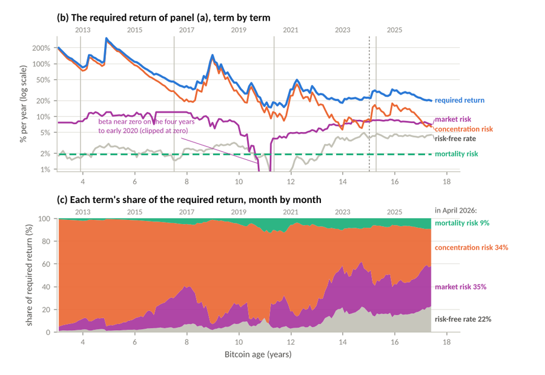
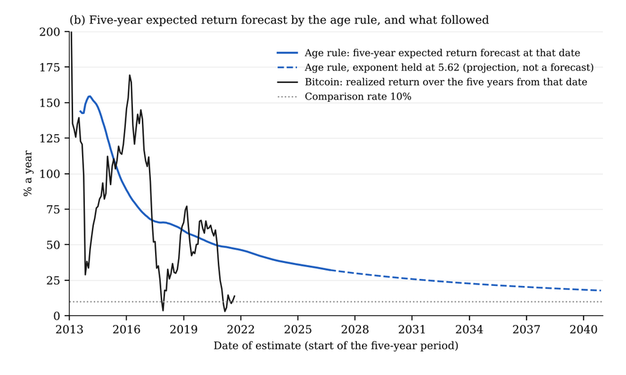
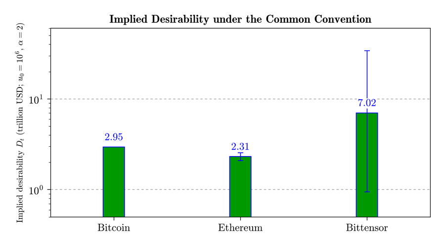

## Agisilaos Papadogiannis

Engineer by training (PhD, MBA), with a research background in wireless communications. I do independent research in finance: asset valuation, expected returns, and the economics of money and AI.

Every paper of mine with a number in it ships with a replication package here: manuscript, data, code, and one script that regenerates every table and figure. The green badge on each is live. GitHub re-runs the full pipeline on a clean machine at every change and once a month, and the badge turns red if a single table differs from the published one.

### Replication packages

<table>
<tr>
<td width="42%" valign="middle">

</td>
<td valign="top">

<b><a href="https://github.com/apapadogiannis/bitcoin-required-return">Bitcoin's Required Return: Pricing a New Asset Beside Equities and Gold</a></b>

The MCM equation: the return Bitcoin's holders should require is the risk-free rate plus market, concentration and mortality risk. For 2026 that is about 18% a year (90% range 15–22%). Built on a census of 1,815 cryptoassets with 520 deaths; an audit script re-checks every number in the paper.

  

</td>
</tr>
<tr>
<td width="42%" valign="middle">

</td>
<td valign="top">

<b><a href="https://github.com/apapadogiannis/bitcoin-age-rule">Bitcoin's Expected Return: An Age Rule That Beats Current Practice</a></b>

A backtest, since 2012, of the ways practitioners set Bitcoin's long-run expected return. Constant rates of 7–21% a year were beaten in about nine periods in ten; a rule based on Bitcoin's age comes closest.

  

</td>
</tr>
<tr>
<td width="42%" valign="middle">

</td>
<td valign="top">

<b><a href="https://github.com/apapadogiannis/economic-scarcity-as-value">Economic Scarcity as Value: A Universal Framework for Blockchain and Beyond</a></b>

Network value written as desirability times scarcity times adoption, applied to Bitcoin, Ethereum and Bittensor. Bitcoin and Ethereum come out within about 25% of each other; Bittensor's valuation rests mainly on expectations.

  

</td>
</tr>
</table>

### Elsewhere

All 23 papers are on SSRN. Contact: apapadogiannis@gmail.com
