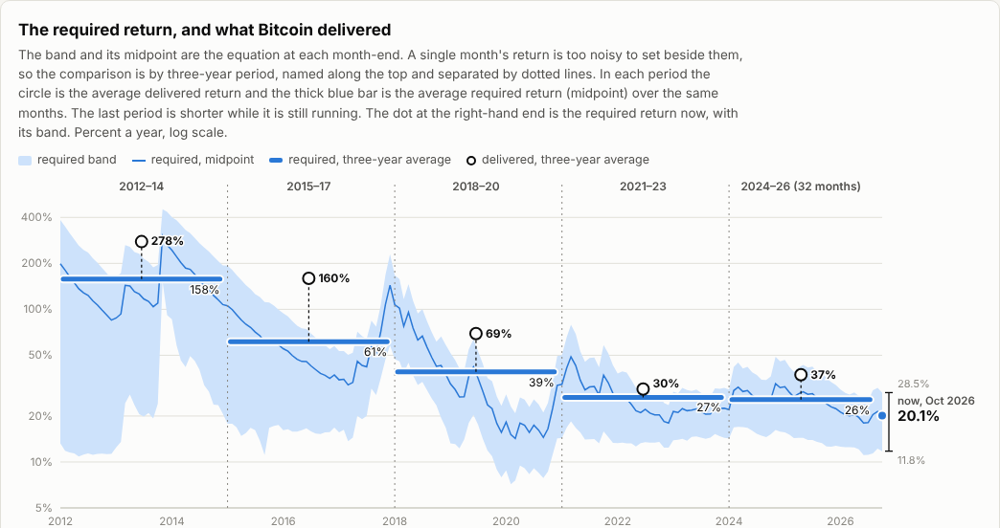
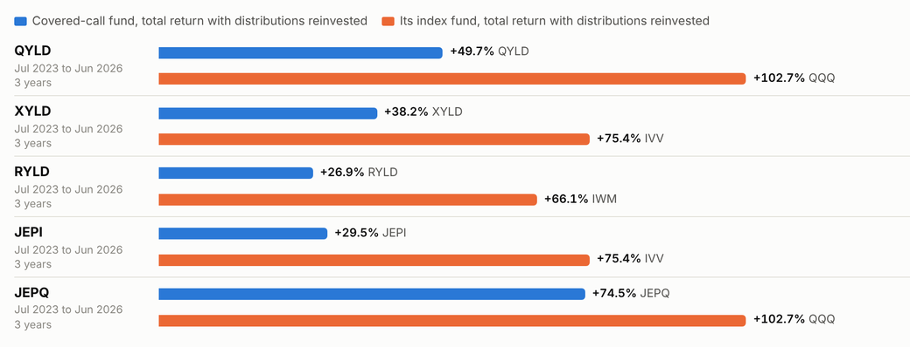

## Agisilaos Papadogiannis

Engineer by training (PhD, MBA). My first research career was in wireless communications, with IEEE publications that have drawn about 2,000 citations. I now do independent research in finance, published in peer-reviewed journals.

This page holds open finance research whose every published number is recomputed automatically, with machine-readable results and stated limits. It comes in two forms. **Tools** recompute their figures from current public data, on a page that updates itself. **Replication packages** hold the data and code behind a paper and are re-run on a clean machine at every change; 8 of the 21 papers below have one so far. The work is unfunded and independent, and corrections are welcome.

The work follows value through four questions: where it comes from (value creation), what return an asset must earn and can be expected to earn (returns), what it is worth once both are known (valuation), and what its holder actually keeps (value capture).

**For AI agents and programs:** [llms.txt](llms.txt) lists every tool, paper and replication package. Where one has a guide, it gives the address; the guide says what the repository holds, what it adds, which file to use and what not to use it for.

<picture>
<source media="(prefers-color-scheme: dark)" srcset="assets/map-dark.svg">
<source media="(prefers-color-scheme: light)" srcset="assets/map-light.svg">

</picture>

### Tools

Research that keeps running: each tool recomputes its figures from current public data, on a page that updates itself. The badge shows the latest automated check, which must reproduce a fixed set of reference results before the page is rebuilt.

<table>
<tr>
<td width="45%" valign="top">

</td>
<td valign="top">

<b><a href="https://apapadogiannis.github.io/crypto-observatory/">Crypto Observatory: required returns, risks and survival</a></b>

What return should Bitcoin's holders require, and did they get it? The answer is recomputed every month from public data, with the equation explained term by term, the tests of fit, and a census of cryptoasset deaths.

<a href="https://apapadogiannis.github.io/crypto-observatory/">Open the page</a> · <a href="https://github.com/apapadogiannis/crypto-observatory">Code and data</a> 

Method: <a href="https://ssrn.com/abstract=7705239">Bitcoin's Required Return: Pricing a New Asset Beside Equities and Gold</a>

</td>
</tr>
</table>

<table>
<tr>
<td width="45%" valign="top">

</td>
<td valign="top">

<b><a href="https://apapadogiannis.github.io/covered-call-monitor/">Covered-Call Monitor: returns, overlays and flows from SEC filings</a></b>

What does the yield cost? For 87 US covered-call, buy-write and premium-income funds: the total return with distributions reinvested, beside an index fund where one applies, the options each fund had actually written, and the money moving in and out. Rebuilt every quarter from SEC filings, with data files and a guide for programs and AI agents.

<a href="https://apapadogiannis.github.io/covered-call-monitor/">Open the page</a> · <a href="https://github.com/apapadogiannis/covered-call-monitor">Code and data</a> 

Background: <a href="https://ssrn.com/abstract=5370897">High Yield, Capped Gains: Mechanics, Trade-Offs, and Practical Diagnostics for Covered-Call ETFs</a>

</td>
</tr>
</table>

### Featured replication packages

One per question. Each holds the data and code behind a paper, with one script that regenerates every table and figure.

<table>
<tr>
<td width="25%" valign="top">

<b><a href="https://github.com/apapadogiannis/economic-scarcity-as-value">Economic Scarcity as Value: A Universal Framework for Blockchain and Beyond</a></b>

Network value written as desirability times scarcity times adoption, for Bitcoin, Ethereum and Bittensor.

</td>
<td width="25%" valign="top">

<b><a href="https://github.com/apapadogiannis/bitcoin-required-return">Bitcoin's Required Return: Pricing a New Asset Beside Equities and Gold</a></b>

The MCM equation prices market, concentration and mortality risk: about 18% a year for 2026.

</td>
<td width="25%" valign="top">

<b><a href="https://github.com/apapadogiannis/beyond-discount-rates">Beyond Discount Rates: A Valuation Framework for Unpriced Systematic Risk</a></b>

A cost of capital for priced risk, plus a gain of capital when expected cash flows are misestimated.

</td>
<td width="25%" valign="top">

<b><a href="https://github.com/apapadogiannis/ai-broad-index-investing">Does AI break the case for broad index investing? Rent decay, private capital, and deflation</a></b>

Since ChatGPT the S&amp;P 500 returned 19% a year against 11% equal-weighted: a capitalization-weighted index follows rents as AI moves them.

</td>
</tr>
</table>

### All papers by question

Click a line to open its list. Where a paper has a replication package, the green badge is live: GitHub re-runs the full pipeline on a clean machine at every change and once a month, and the badge turns red if any stored result is not reproduced to nine significant digits.

 <b>Value creation</b>: where value comes from (8 papers, 3 with a replication package)

<ul>
<li><b>Economic Scarcity as Value: A Universal Framework for Blockchain and Beyond</b>. <a href="https://ssrn.com/abstract=5384204">SSRN</a> · <a href="https://github.com/apapadogiannis/economic-scarcity-as-value">Replication package</a> </li>
<li><b>The Architecture of Blockchain Value: Capabilities, Pillars, and Growth Dynamics</b>. Frontiers in Blockchain, 2026. <a href="https://ssrn.com/abstract=5401302">SSRN</a> · <a href="https://www.frontiersin.org/journals/blockchain/articles/10.3389/fbloc.2026.1747512/full">Published version</a> · <a href="https://github.com/apapadogiannis/architecture-of-blockchain-value">Replication package</a>  · <a href="https://apapadogiannis.github.io/architecture-of-blockchain-value/">Interactive demo</a></li>
<li><b>Bitcoin Is Not Money: Why Fixed Supply Fails in a Modern Economy</b>. Asian Economics Letters, forthcoming. <a href="https://ssrn.com/abstract=5435197">SSRN</a> · <a href="https://github.com/apapadogiannis/bitcoin-is-not-money">Replication package</a> </li>
<li><b>Valuing Scarcity: A General Framework for Bitcoin, Gold, and Traditional Assets</b>. Financial Economics Letters, 2026. <a href="https://ssrn.com/abstract=5289457">SSRN</a> · <a href="https://doi.org/10.58567/fel05020001">Published version</a></li>
<li><b>Scarcity in an Age of AI Abundance</b>. <a href="https://ssrn.com/abstract=5924462">SSRN</a></li>
<li><b>What Moves the Price of Gold: An Economic-Scarcity Lens on Policy, the Dollar, and the Debasement Trade</b>. <a href="https://ssrn.com/abstract=5619373">SSRN</a></li>
<li><b>The Productivity Myth: Why Scarcity Drives All Value</b>. <a href="https://ssrn.com/abstract=5367197">SSRN</a></li>
<li><b>How to Classify any Asset: Ontology, Anchor, Rail, Composability</b>. <a href="https://ssrn.com/abstract=5635610">SSRN</a></li>
</ul>

 <b>Returns</b>: required and expected (5 papers, 2 with a replication package)

<ul>
<li><b>Bitcoin's Required Return: Pricing a New Asset Beside Equities and Gold</b>. <a href="https://ssrn.com/abstract=7705239">SSRN</a> · <a href="https://github.com/apapadogiannis/bitcoin-required-return">Replication package</a>  · <a href="https://apapadogiannis.github.io/crypto-observatory/">Live tool</a></li>
<li><b>Bitcoin's Expected Return: An Age Rule That Beats Current Practice</b>. <a href="https://ssrn.com/abstract=7705438">SSRN</a> · <a href="https://github.com/apapadogiannis/bitcoin-age-rule">Replication package</a> </li>
<li><b>On the Physics of Expected Asset Returns</b>. <a href="https://ssrn.com/abstract=6586879">SSRN</a></li>
<li><b>Scarcity-Aligned Discounting in Asset Valuation</b>. <a href="https://ssrn.com/abstract=5368003">SSRN</a></li>
<li><b>The Bitcoin Hurdle Fallacy: Why Risk Misalignment Distorts Valuation</b>. <a href="https://ssrn.com/abstract=5368091">SSRN</a></li>
</ul>

 <b>Valuation</b>: the dual-risk framework (5 papers, 1 with a replication package)

<ul>
<li><b>Beyond Discount Rates: A Valuation Framework for Unpriced Systematic Risk</b>. The Journal of Investing, forthcoming 2027. <a href="https://ssrn.com/abstract=5180040">SSRN</a> · <a href="https://github.com/apapadogiannis/beyond-discount-rates">Replication package</a> </li>
<li><b>A Dual-Risk Theory of Valuation: Bridging Discounting and Expectational Distortion</b>. Discover Analytics, 2026. <a href="https://ssrn.com/abstract=5226017">SSRN</a> · <a href="https://doi.org/10.1007/s44257-026-00062-9">Published version</a></li>
<li><b>From Unified Discounting to Dual-Risk: A New Lens on DCF Valuation</b>. Finance Research Open, 2026. <a href="https://ssrn.com/abstract=6127866">SSRN</a> · <a href="https://doi.org/10.1016/j.finr.2026.100096">Published version</a></li>
<li><b>Rethinking Capital Budgeting: Embedding Ex-Ante Alpha in the Cost of Capital</b>.</li>
<li><b>Unifying DCF Valuation Across Traditional and Cryptoassets</b>. <a href="https://ssrn.com/abstract=5363661">SSRN</a></li>
</ul>

 <b>Value capture</b>: what the holder actually keeps (3 papers, 2 with a replication package)

<ul>
<li><b>Does AI break the case for broad index investing? Rent decay, private capital, and deflation</b>. The Journal of Beta Investment Strategies, forthcoming 2027. <a href="https://ssrn.com/abstract=6058896">SSRN</a> · <a href="https://github.com/apapadogiannis/ai-broad-index-investing">Replication package</a> </li>
<li><b>High Yield, Capped Gains: Mechanics, Trade-Offs, and Practical Diagnostics for Covered-Call ETFs</b>. The Journal of Beta Investment Strategies, 2026. <a href="https://ssrn.com/abstract=5370897">SSRN</a> · <a href="https://doi.org/10.3905/jbis.2026.001">Published version</a> · <a href="https://github.com/apapadogiannis/covered-call-etfs">Replication package</a>  · <a href="https://apapadogiannis.github.io/covered-call-monitor/">Live tool</a></li>
<li><b>Crypto Treasury Companies: Financing Dynamics, Accretion Conditions, and Systemic Risk</b>. <a href="https://ssrn.com/abstract=5487486">SSRN</a></li>
</ul>

