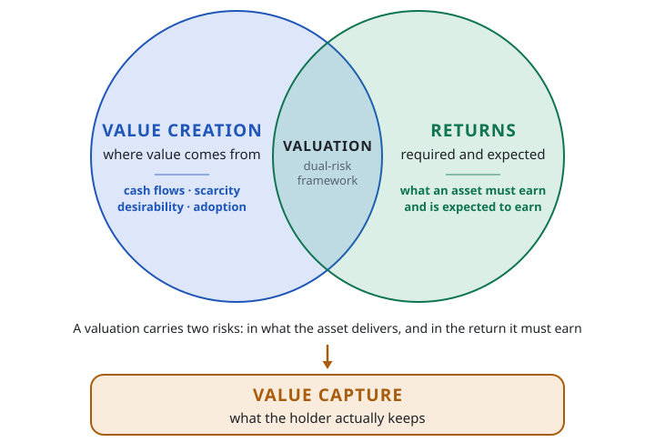
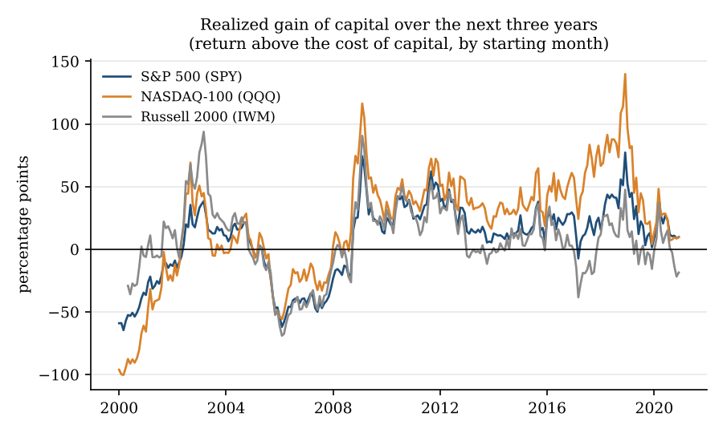

## Agisilaos Papadogiannis

**Independent finance research on what an asset is worth and what return it must earn.** It comes in three forms: three tools you can use now, 21 papers, and the data and code to check nine of them.

<a href="https://papers.ssrn.com/sol3/cf_dev/AbsByAuth.cfm?per_id=7457522">SSRN</a> · <a href="https://scholar.google.com/citations?user=RihXr08AAAAJ">Google Scholar</a> · <a href="https://orcid.org/0009-0002-7753-7052">ORCID</a> · <a href="https://scarcitythinker.substack.com">Substack</a> · <a href="mailto:apapadogiannis@gmail.com">Email</a>

| If you want to | Start here |
|---|---|
| get an answer to a question | [Tools](#tools): three pages, free, no account |
| ask through your own AI assistant | [For your AI assistant](#for-your-ai-assistant): one skill, and a calculator it can call |
| read the research or check a number | [The research](#the-research-one-corpus-four-questions): 21 papers, 9 with data and code |

### Tools

Each answers one question, from current public data or from your own numbers. The figures below are read from the tools' own data files every month.

<table>
<tr>
<td width="33%" valign="top">
<h4>Crypto Observatory</h4>
<p>What return should Bitcoin's holders require, and did they get it?</p>
<p><sub>Bitcoin's required return, October 2026</sub></p>
<h3>20.1% a year</h3>
<p><sub>The midpoint of a range from 11.8% to 28.5% across the model's inputs. The paper's 18.3% is the median over the same inputs. Recomputed every month.</sub></p>
<p><b><a href="https://apapadogiannis.github.io/crypto-observatory/">Open the tool</a></b></p>
<p></p>
</td>
<td width="33%" valign="top">
<h4>Covered-Call Monitor</h4>
<p>What does the yield of a covered-call fund cost against its index fund?</p>
<p><sub>Covered-call funds followed, each from its SEC filings</sub></p>
<h3>87 funds</h3>
<p><sub>18 of them can be set beside an index fund on the same market. Over the 12 months to June 2026, all 18 returned less than it, by 5.5 percentage points at the median, distributions reinvested. Rebuilt every quarter.</sub></p>
<p><b><a href="https://apapadogiannis.github.io/covered-call-monitor/">Open the tool</a></b></p>
<p></p>
</td>
<td width="33%" valign="top">
<h4>Dual-Risk DCF Calculator</h4>
<p>How much of a valuation gap is the forecast, and how much the discount rate?</p>
<p><sub>Example: a forecast 10% too low, valued at 8% over 5 years</sub></p>
<h3>K = 1.11</h3>
<p><sub>One discount rate would have to fall to 4.1% to hide the gap. Enter your own forecasts or prices.</sub></p>
<p><b><a href="https://apapadogiannis.github.io/dual-risk-calculator/">Open the tool</a></b></p>
<p></p>
</td>
</tr>
</table>

All three on one page, each with its chart: **[apapadogiannis.github.io](https://apapadogiannis.github.io/)**

### For your AI assistant

A skill is a short instruction file that you add once to an AI assistant such as Claude. From then on you can ask in plain words, and the assistant answers from the latest figures here, with the date and the source, instead of from memory. It is free and needs no account or key. It holds no figures, so it does not go out of date.

**One skill covers everything here:** <a href="https://github.com/apapadogiannis/apapadogiannis/blob/main/skill/SKILL.md"><code>papadogiannis-finance-research</code></a>. With it your assistant can answer, for example:

<table>
<tr><th>What it answers</th><th>A question to try</th></tr>
<tr><td>Bitcoin's required return, its parts and its record</td><td>“What return should Bitcoin's holders require now, and how is it made up?”</td></tr>
<tr><td>Covered-call funds: returns, written calls and flows</td><td>“How did JEPI do against its index fund over three years?”</td></tr>
<tr><td>Splitting a valuation gap into the discount rate and the forecast, from your own numbers</td><td>“My forecast is 90 a year for five years and the benchmark is 100. At 8%, what is K and the effective rate?”</td></tr>
<tr><td>A number or a finding from any of the papers</td><td>“What does the age-rule paper report for Bitcoin's expected return?”</td></tr>
</table>

<details>
<summary>How to add it</summary>

In Claude Code, one file in one folder:

```
mkdir -p ~/.claude/skills/papadogiannis-finance-research
curl -o ~/.claude/skills/papadogiannis-finance-research/SKILL.md https://raw.githubusercontent.com/apapadogiannis/apapadogiannis/main/skill/SKILL.md
```

In another assistant, add the same file wherever it takes instructions or skills, or give it the address of [llms.txt](llms.txt). Each tool also publishes a narrower skill for that tool alone: [`crypto-observatory`](https://github.com/apapadogiannis/crypto-observatory/blob/main/api/SKILL.md); [`covered-call-monitor`](https://github.com/apapadogiannis/covered-call-monitor/blob/main/api/SKILL.md); [`dual-risk-calculator`](https://github.com/apapadogiannis/dual-risk-calculator/blob/main/api/SKILL.md). The Bitcoin and Ether price inputs come from Coin Metrics community data, which are for non-commercial use, as the Observatory's guide states.

</details>

**The calculator is also an MCP server.** A skill tells an assistant where to read figures. An MCP server gives it a tool to call: the assistant sends your numbers and gets the result computed, not estimated. It runs on your own machine, and the install line is in [its repository](https://github.com/apapadogiannis/dual-risk-calculator#use-it-from-your-own-ai-agent).

<sub>AI agents and programs: start at [llms.txt](llms.txt), the index of every tool, paper and data file, with the tools' latest figures and one sentence on what each paper finds.</sub>

### The research: one corpus, four questions

The papers are written to be used together, as one corpus on value. It follows value through four questions: where it comes from, what return it must earn, what it is worth once both are known, and what its holder actually keeps. Of the 21 papers, 10 are published or forthcoming and 9 have a replication package with the data and code (6 are both).

The journals: Financial Economics Letters, Frontiers in Blockchain, Asian Review of Political Economy, Asian Economics Letters, The Journal of Investing, Discover Analytics, Finance Research Open, Economics Bulletin and The Journal of Beta Investment Strategies. In the three tools and the nine replication packages, every published number is recomputed automatically, with machine-readable results and stated limits. The other 12 papers are papers only.

<p align="center">
<picture>
<source media="(prefers-color-scheme: dark)" srcset="assets/map-dark.svg">
<source media="(prefers-color-scheme: light)" srcset="assets/map-light.svg">

</picture>
</p>

### Four papers, one per question

Each comes with its data and code.

<table>
<tr>
<td width="25%" valign="top">
<p></p>

<p></p>
<p><b><a href="https://github.com/apapadogiannis/economic-scarcity-as-value">Economic Scarcity as Value: A Universal Framework for Blockchain and Beyond</a></b></p>
<p>Network value written as desirability times scarcity times adoption, for Bitcoin, Ethereum and Bittensor.</p>
<p></p>
</td>
<td width="25%" valign="top">
<p></p>

<p></p>
<p><b><a href="https://github.com/apapadogiannis/bitcoin-required-return">Bitcoin's Required Return: Pricing a New Asset Beside Equities and Gold</a></b></p>
<p>The MCM equation prices market, concentration and mortality risk: about 18% a year for 2026 at the median. The live tool above shows the midpoint of its band.</p>
<p></p>
</td>
<td width="25%" valign="top">
<p></p>

<p></p>
<p><b><a href="https://github.com/apapadogiannis/beyond-discount-rates">Beyond Discount Rates: A Valuation Framework for Unpriced Systematic Risk</a></b></p>
<p>A cost of capital for priced risk, plus a gain of capital when expected cash flows are misestimated.</p>
<p></p>
</td>
<td width="25%" valign="top">
<p></p>

<p></p>
<p><b><a href="https://github.com/apapadogiannis/ai-broad-index-investing">Does AI break the case for broad index investing? Rent decay, private capital, and deflation</a></b></p>
<p>Since ChatGPT the S&amp;P 500 returned 19% a year against 11% equal-weighted: a capitalization-weighted index follows rents as AI moves them.</p>
<p></p>
</td>
</tr>
</table>

### All papers by question

Click a line to open its list. A green badge means the package's stored results were reproduced at the last automated run.

<details>
<summary> <b>Value creation</b>: where value comes from (8 papers, 3 with a replication package, 1 with a paper record)</summary>
<ul>
<li><b>Economic Scarcity as Value: A Universal Framework for Blockchain and Beyond</b>. <a href="https://ssrn.com/abstract=5384204">SSRN</a> · <a href="https://github.com/apapadogiannis/economic-scarcity-as-value">Replication package</a> <a href="https://github.com/apapadogiannis/economic-scarcity-as-value/actions/workflows/replicate.yml"></a><br><sub>Writes the value of a network as desirability times scarcity times adoption and applies it to Bitcoin, Ethereum and Bittensor; scarcity is scored from protocol features, and desirability is what remains, as implied volatility is recovered from an option price.</sub></li>
<li><b>The Architecture of Blockchain Value: Capabilities, Pillars, and Growth Dynamics</b>. Frontiers in Blockchain, 2026. <a href="https://ssrn.com/abstract=5401302">SSRN</a> · <a href="https://www.frontiersin.org/journals/blockchain/articles/10.3389/fbloc.2026.1747512/full">Published version</a> · <a href="https://github.com/apapadogiannis/architecture-of-blockchain-value">Replication package</a> <a href="https://github.com/apapadogiannis/architecture-of-blockchain-value/actions/workflows/replicate.yml"></a> · <a href="https://apapadogiannis.github.io/architecture-of-blockchain-value/">Interactive demo</a><br><sub>A theory of what a blockchain can deliver, its capabilities, and of how five architectural pillars decide which capabilities are feasible. It estimates nothing and uses no dataset.</sub></li>
<li><b>Bitcoin Is Not Money: Why Fixed Supply Fails in a Modern Economy</b>. Asian Economics Letters, forthcoming. <a href="https://ssrn.com/abstract=5435197">SSRN</a> · <a href="https://github.com/apapadogiannis/bitcoin-is-not-money">Replication package</a> <a href="https://github.com/apapadogiannis/bitcoin-is-not-money/actions/workflows/replicate.yml"></a><br><sub>With a fixed money stock and stable velocity, output growth implies deflation at the same rate, so a money with a fixed supply could not serve a growing economy.</sub></li>
<li><b>Scarcity in an age of AI abundance</b>. Asian Review of Political Economy, forthcoming 2027. <a href="https://ssrn.com/abstract=5924462">SSRN</a> · <a href="https://github.com/apapadogiannis/ai-abundance">Paper record</a> <a href="https://github.com/apapadogiannis/ai-abundance/actions/workflows/check.yml"></a><br><sub>AI can make many goods cheap to produce without making an essential standard of living broadly affordable, because scarcity and its rents move to five layers: physical resources, infrastructure, capabilities, institutions and jurisdictions.</sub></li>
<li><b>Valuing Scarcity: A General Framework for Bitcoin, Gold, and Traditional Assets</b>. Financial Economics Letters, 2026. <a href="https://ssrn.com/abstract=5289457">SSRN</a> · <a href="https://doi.org/10.58567/fel05020001">Published version</a></li>
<li><b>What Moves the Price of Gold: An Economic-Scarcity Lens on Policy, the Dollar, and the Debasement Trade</b>. <a href="https://ssrn.com/abstract=5619373">SSRN</a></li>
<li><b>The Productivity Myth: Why Scarcity Drives All Value</b>. <a href="https://ssrn.com/abstract=5367197">SSRN</a></li>
<li><b>How to Classify any Asset: Ontology, Anchor, Rail, Composability</b>. <a href="https://ssrn.com/abstract=5635610">SSRN</a></li>
</ul>
</details>

<details>
<summary> <b>Returns</b>: required and expected (5 papers, 2 with a replication package)</summary>
<ul>
<li><b>Bitcoin's Required Return: Pricing a New Asset Beside Equities and Gold</b>. <a href="https://ssrn.com/abstract=7705239">SSRN</a> · <a href="https://github.com/apapadogiannis/bitcoin-required-return">Replication package</a> <a href="https://github.com/apapadogiannis/bitcoin-required-return/actions/workflows/replicate.yml"></a> · <a href="https://apapadogiannis.github.io/crypto-observatory/">Live tool</a><br><sub>Asks what return Bitcoin's holders should require for the market, concentration and mortality risk they carry (the MCM equation), tests the answer against delivered returns, and takes a census of cryptoasset deaths.</sub></li>
<li><b>Bitcoin's Expected Return: An Age Rule That Beats Current Practice</b>. <a href="https://ssrn.com/abstract=7705438">SSRN</a> · <a href="https://github.com/apapadogiannis/bitcoin-age-rule">Replication package</a> <a href="https://github.com/apapadogiannis/bitcoin-age-rule/actions/workflows/replicate.yml"></a><br><sub>Tests the ways practitioners set Bitcoin's long-run expected return against the returns that followed since 2012; fixed rates and trailing averages fail, and an age rule, the power-law exponent divided by Bitcoin's age, comes closest.</sub></li>
<li><b>On the Physics of Expected Asset Returns</b>. <a href="https://ssrn.com/abstract=6586879">SSRN</a></li>
<li><b>Scarcity-Aligned Discounting in Asset Valuation</b>. <a href="https://ssrn.com/abstract=5368003">SSRN</a></li>
<li><b>The Bitcoin Hurdle Fallacy: Why Risk Misalignment Distorts Valuation</b>. <a href="https://ssrn.com/abstract=5368091">SSRN</a></li>
</ul>
</details>

<details>
<summary> <b>Valuation</b>: the dual-risk framework (5 papers, 2 with a replication package)</summary>
<ul>
<li><b>Beyond Discount Rates: A Valuation Framework for Unpriced Systematic Risk</b>. The Journal of Investing, forthcoming 2027. <a href="https://ssrn.com/abstract=5180040">SSRN</a> · <a href="https://github.com/apapadogiannis/beyond-discount-rates">Replication package</a> <a href="https://github.com/apapadogiannis/beyond-discount-rates/actions/workflows/replicate.yml"></a><br><sub>Splits an asset's expected return into a cost of capital and a gain of capital, the part that comes from misjudged future cash flows, and measures both for three US equity index funds, 2000 to 2023.</sub></li>
<li><b>From Unified Discounting to Dual-Risk: A New Lens on DCF Valuation</b>. Finance Research Open, 2026. <a href="https://ssrn.com/abstract=5252774">SSRN</a> · <a href="https://doi.org/10.1016/j.finr.2026.100096">Published version</a> · <a href="https://github.com/apapadogiannis/dual-risk-dcf">Replication package</a> <a href="https://github.com/apapadogiannis/dual-risk-dcf/actions/workflows/replicate.yml"></a> · <a href="https://apapadogiannis.github.io/dual-risk-calculator/">Calculator</a><br><sub>Separates a benchmark cost of capital, set outside the asset, from a valuation ratio K, fair value over valuation, and illustrates both on Bitcoin, US equities and gold.</sub></li>
<li><b>A Dual-Risk Theory of Valuation: Bridging Discounting and Expectational Distortion</b>. Discover Analytics, 2026. <a href="https://ssrn.com/abstract=5226017">SSRN</a> · <a href="https://doi.org/10.1007/s44257-026-00062-9">Published version</a></li>
<li><b>Rethinking Capital Budgeting: Embedding Ex-Ante Alpha in the Cost of Capital</b>. Economics Bulletin, 2026. <a href="https://ideas.repec.org/a/ebl/ecbull/eb-25-00176.html">Published version</a><br><sub>An effective cost of capital that adjusts the benchmark rate for the systematic part of the bias in cash-flow forecasts, so that valuation and the decision to accept a project are kept apart.</sub></li>
<li><b>Unifying DCF Valuation Across Traditional and Cryptoassets</b>. <a href="https://ssrn.com/abstract=5363661">SSRN</a></li>
</ul>
</details>

<details>
<summary> <b>Value capture</b>: what the holder actually keeps (3 papers, 2 with a replication package)</summary>
<ul>
<li><b>Does AI break the case for broad index investing? Rent decay, private capital, and deflation</b>. The Journal of Beta Investment Strategies, forthcoming 2027. <a href="https://ssrn.com/abstract=6058896">SSRN</a> · <a href="https://github.com/apapadogiannis/ai-broad-index-investing">Replication package</a> <a href="https://github.com/apapadogiannis/ai-broad-index-investing/actions/workflows/replicate.yml"></a><br><sub>Asks whether AI weakens the case for holding a broad capitalization-weighted index, and concludes that it does not: such an index follows the rents as AI moves them.</sub></li>
<li><b>High Yield, Capped Gains: Mechanics, Trade-Offs, and Practical Diagnostics for Covered-Call ETFs</b>. The Journal of Beta Investment Strategies, 2026. <a href="https://ssrn.com/abstract=5370897">SSRN</a> · <a href="https://doi.org/10.3905/jbis.2026.001">Published version</a> · <a href="https://github.com/apapadogiannis/covered-call-etfs">Replication package</a> <a href="https://github.com/apapadogiannis/covered-call-etfs/actions/workflows/replicate.yml"></a> · <a href="https://apapadogiannis.github.io/covered-call-monitor/">Live tool</a><br><sub>Explains how covered-call funds turn upside into distributions, what that costs in rising markets, and what to look at in a fund.</sub></li>
<li><b>Crypto Treasury Companies: Financing Dynamics, Accretion Conditions, and Systemic Risk</b>. <a href="https://ssrn.com/abstract=5487486">SSRN</a></li>
</ul>
</details>

### About

Engineer by training (PhD, MBA). My first research career was in wireless communications, with IEEE publications that have drawn about 2,000 citations. The finance research is independent and unfunded. Corrections and questions are welcome, by email or as an issue on the repository concerned.
