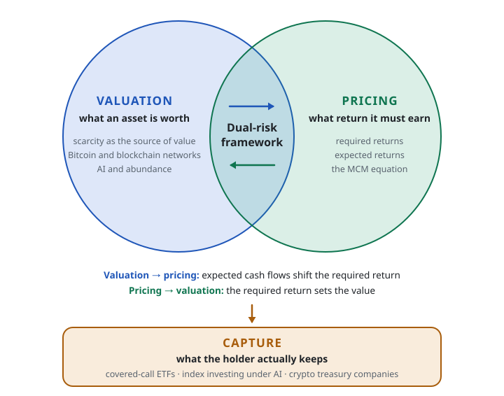
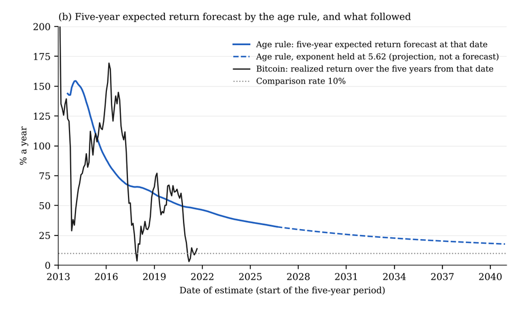
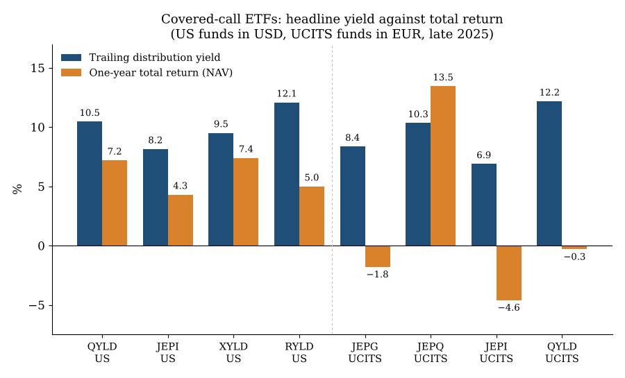

## Agisilaos Papadogiannis

Engineer by training (PhD, MBA). My first research career was in wireless communications, with IEEE publications that have drawn about 2,000 citations. I now do independent research in finance, published in peer-reviewed journals.

My work asks three questions about assets: what they are worth (valuation), what return they must earn (pricing), and what their holders actually keep (capture). I treat research as engineering: every empirical result comes with open data and code, written in Python and re-run automatically on GitHub.

<picture>
<source media="(prefers-color-scheme: dark)" srcset="assets/research-map-dark.svg">
<source media="(prefers-color-scheme: light)" srcset="assets/research-map-light.svg">

</picture>

<b>Papers by question.</b> Click a line to open its list.

 <b>Valuation</b>: what an asset is worth (8 papers)

<ul>
<li><i>Valuing Scarcity: A General Framework for Bitcoin, Gold, and Traditional Assets.</i> Financial Economics Letters, 2026.</li>
<li><i>Economic Scarcity as Value: A Universal Framework for Blockchain and Beyond.</i> Working paper. <a href="https://github.com/apapadogiannis/economic-scarcity-as-value">Replication package</a>.</li>
<li><i>The Architecture of Blockchain Value: Capabilities, Pillars, and Growth Dynamics.</i> Frontiers in Blockchain.</li>
<li><i>Scarcity in an Age of AI Abundance.</i></li>
<li><i>What Moves the Price of Gold: An Economic-Scarcity Lens on Policy, the Dollar, and the Debasement Trade.</i></li>
<li><i>The Productivity Myth: Why Scarcity Drives All Value.</i></li>
<li><i>Bitcoin Is Not Money: Why Fixed Supply Fails in a Modern Economy.</i></li>
<li><i>How to Classify any Asset: Ontology, Anchor, Rail, Composability.</i></li>
</ul>

 <b>Pricing</b>: what return it must earn (5 papers)

<ul>
<li><i>Bitcoin's Required Return: Pricing a New Asset Beside Equities and Gold.</i> Working paper. <a href="https://github.com/apapadogiannis/bitcoin-required-return">Replication package</a>.</li>
<li><i>Bitcoin's Expected Return: An Age Rule That Beats Current Practice.</i> Working paper. <a href="https://github.com/apapadogiannis/bitcoin-age-rule">Replication package</a>.</li>
<li><i>On the Physics of Expected Asset Returns.</i></li>
<li><i>Scarcity-Aligned Discounting in Asset Valuation.</i></li>
<li><i>The Bitcoin Hurdle Fallacy: Why Risk Misalignment Distorts Valuation.</i></li>
</ul>

 <b>Dual-risk framework</b>: where valuation and pricing meet (5 papers)

<ul>
<li><i>A Dual-Risk Theory of Valuation: Bridging Discounting and Expectational Distortion.</i> Discover Analytics, 2026.</li>
<li><i>From Unified Discounting to Dual-Risk: A New Lens on DCF Valuation.</i> Finance Research Open, 2026.</li>
<li><i>Beyond Discount Rates: A Valuation Framework for Unpriced Systematic Risk.</i> The Journal of Investing, forthcoming 2027. <a href="https://github.com/apapadogiannis/beyond-discount-rates">Replication package</a>.</li>
<li><i>Rethinking Capital Budgeting: Embedding Ex-Ante Alpha in the Cost of Capital.</i></li>
<li><i>Unifying DCF Valuation Across Traditional and Cryptoassets.</i></li>
</ul>

 <b>Capture</b>: what the holder actually keeps (3 papers)

<ul>
<li><i>High Yield, Capped Gains: Mechanics, Trade-Offs, and Practical Diagnostics for Covered-Call ETFs.</i> The Journal of Beta Investment Strategies, 2026. <a href="https://github.com/apapadogiannis/covered-call-etfs">Replication package</a>.</li>
<li><i>Does AI Break the Case for Broad Index Investing? Rent Decay, Private Capital, and Deflation.</i> The Journal of Beta Investment Strategies, forthcoming 2027. <a href="https://github.com/apapadogiannis/ai-broad-index-investing">Replication package</a>.</li>
<li><i>Crypto Treasury Companies: Financing Dynamics, Accretion Conditions, and Systemic Risk.</i></li>
</ul>

Every paper of mine with a number in it ships with a replication package here: manuscript, data, code, and one script that regenerates every table and figure. The coloured tag on each shows which of the questions above it answers, and the green badge is live. GitHub re-runs the full pipeline on a clean machine at every change and once a month, and the badge turns red if a single table differs from the published one.

### Replication packages

<table>
<tr>
<td width="8" valign="middle"></td>
<td width="40%" valign="middle">

</td>
<td valign="top">

<b><a href="https://github.com/apapadogiannis/bitcoin-required-return">Bitcoin's Required Return: Pricing a New Asset Beside Equities and Gold</a></b>

The MCM equation: the return Bitcoin's holders should require is the risk-free rate plus market, concentration and mortality risk. For 2026 that is about 18% a year (90% range 15–22%). Built on a census of 1,815 cryptoassets with 520 deaths; an audit script re-checks every number in the paper.

  

</td>
</tr>
<tr>
<td width="8" valign="middle"></td>
<td width="40%" valign="middle">

</td>
<td valign="top">

<b><a href="https://github.com/apapadogiannis/bitcoin-age-rule">Bitcoin's Expected Return: An Age Rule That Beats Current Practice</a></b>

A backtest, since 2012, of the ways practitioners set Bitcoin's long-run expected return. Constant rates of 7–21% a year were beaten in about nine periods in ten; a rule based on Bitcoin's age comes closest.

  

</td>
</tr>
<tr>
<td width="8" valign="middle"></td>
<td width="40%" valign="middle">

</td>
<td valign="top">

<b><a href="https://github.com/apapadogiannis/economic-scarcity-as-value">Economic Scarcity as Value: A Universal Framework for Blockchain and Beyond</a></b>

Network value written as desirability times scarcity times adoption, applied to Bitcoin, Ethereum and Bittensor. Bitcoin and Ethereum come out within about 25% of each other; Bittensor's valuation rests mainly on expectations.

  

</td>
</tr>
<tr>
<td width="8" valign="middle"></td>
<td width="40%" valign="middle">

</td>
<td valign="top">

<b><a href="https://github.com/apapadogiannis/ai-broad-index-investing">Does AI break the case for broad index investing? Rent decay, private capital, and deflation</a></b>

Forthcoming in <i>The Journal of Beta Investment Strategies</i>. Since the release of ChatGPT the S&amp;P 500 returned 19% a year against 11% for its equal-weighted version, and two of three AI-themed funds trailed it: a capitalization-weighted index follows rents as AI moves them, without a forecast. Code and data only; the article text is copyright PMR.

  

</td>
</tr>
<tr>
<td width="8" valign="middle"></td>
<td width="40%" valign="middle">

</td>
<td valign="top">

<b><a href="https://github.com/apapadogiannis/beyond-discount-rates">Beyond Discount Rates: A Valuation Framework for Unpriced Systematic Risk</a></b>

Forthcoming in <i>The Journal of Investing</i>. Discounted cash flow valuation with two return components: a cost of capital for priced risk and a gain of capital that arises when expected cash flows are misestimated. For SPY, QQQ and IWM from 2000 to 2023 the gain is large and persistent: over one year it exceeds 20 percentage points in 22% of months for SPY and 43% for QQQ. Code and data only; the article text is copyright PMR.

  

</td>
</tr>
<tr>
<td width="8" valign="middle"></td>
<td width="40%" valign="middle">

</td>
<td valign="top">

<b><a href="https://github.com/apapadogiannis/covered-call-etfs">High Yield, Capped Gains: Mechanics, Trade-Offs, and Practical Diagnostics for Covered-Call ETFs</a></b>

Published in <i>The Journal of Beta Investment Strategies</i>, 2026. A primer and due-diligence guide to funds that sell equity upside for option income. Across four US and four UCITS funds in late 2025, distribution yields ran from 7% to 12% a year, while one-year total returns ran from &minus;5% to 13% and fell short of the yield in seven of the eight: a payout is not a return. Code and data only; the article text is copyright PMR.

  

</td>
</tr>
</table>

### Elsewhere

Contact: apapadogiannis@gmail.com
